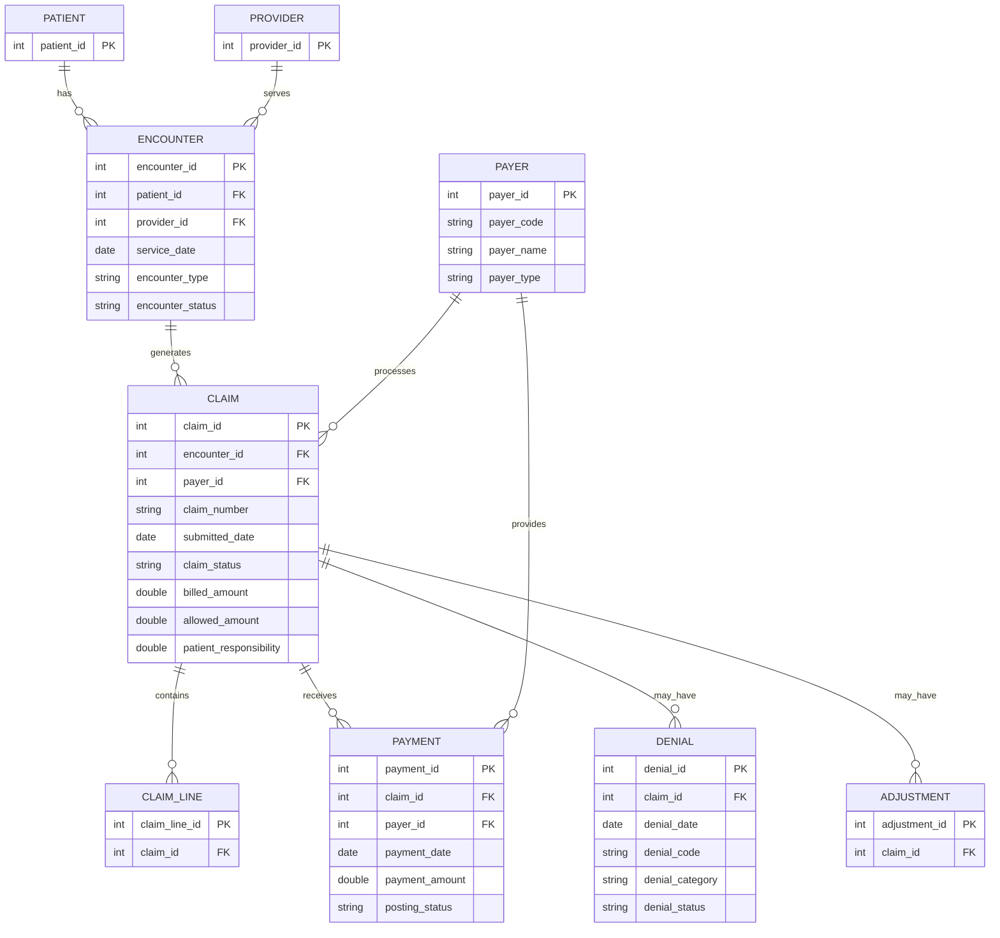

# Healthcare Billing Data Model

## Entity Relationship Diagram

This diagram shows the logical relationships between the nine synthetic healthcare billing entities.

## Entity Descriptions

| Entity | Purpose |
|---|---|
| Patient | Synthetic patient identifiers. |
| Provider | Healthcare service providers. |
| Payer | Insurance payers and self-pay. |
| Encounter | Patient service events. |
| Claim | Billing claims associated with encounters and payers. |
| Claim line | Individual lines within a claim. |
| Payment | Claim payment records and posting status. |
| Denial | Denial codes, categories, and statuses. |
| Adjustment | Claim-related billing adjustments. |

## Notes

- All data is synthetic.
- `PK` means primary key; `FK` means foreign key.
- This is a logical diagram. Verify actual database constraints before treating every relationship as a formal constraint.
